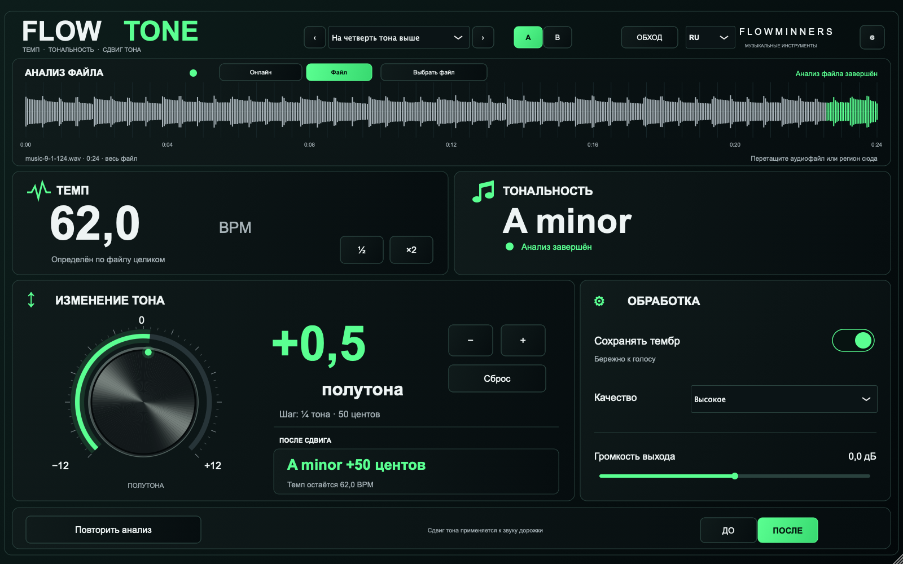

# FLOWTONE

Определяет BPM и тональность, меняет высоту звука без изменения темпа. AU для macOS и VST3 для Windows.

Интерфейс **Русский / English**: переключатель **RU / EN** в верхней панели. Выбор сохраняется в проекте.

- Анализ всего аудиофайла без воспроизведения или онлайн-анализ входа дорожки.
- Проверка устойчивости BPM, предупреждения о неоднозначном и переменном темпе.
- Сдвиг от −12 до +12 полутонов с шагом ¼ тона — 50 центов.
- Сохранение тембра, два режима качества и регулировка громкости.
- A/B, пресеты и сравнение «До / После». Настройки и результат анализа файла сохраняются в проекте.

## Скачать и установить

| Система | Формат | Установщик |
|---|---|---|
| macOS 12+ · Apple Silicon и Intel | AU | [Скачать PKG](https://github.com/Abynarc/FLOWTONE/releases/download/v0.4.0/FLOWTONE-0.4.0-Universal.pkg) |
| Windows 10/11 · x64 | VST3 | [Скачать EXE](https://github.com/Abynarc/FLOWTONE/releases/download/v0.4.0/FLOWTONE-0.4.0-Windows-x64-Setup.exe) |

Закройте секвенсор и запустите установщик. В Logic: **Audio FX → Audio Units → FLOWMINNERS → FLOWTONE**. В FL Studio: **Manage plugins → Find installed plugins**.

Для анализа перетащите файл на осциллограмму или выберите **«Онлайн»** и включите воспроизведение. Регулятор сдвига меняет звук дорожки, включая экспорт проекта; загруженный файл служит только для анализа.

Установщики пока без сертификата издателя.

[Все релизы](https://github.com/Abynarc/FLOWTONE/releases) · [Установка Windows](docs/INSTALL-WINDOWS.md)

[English interface layout and terminology](docs/localisation/DESIGN.md) · [English Windows installation](docs/INSTALL-WINDOWS-EN.md)
